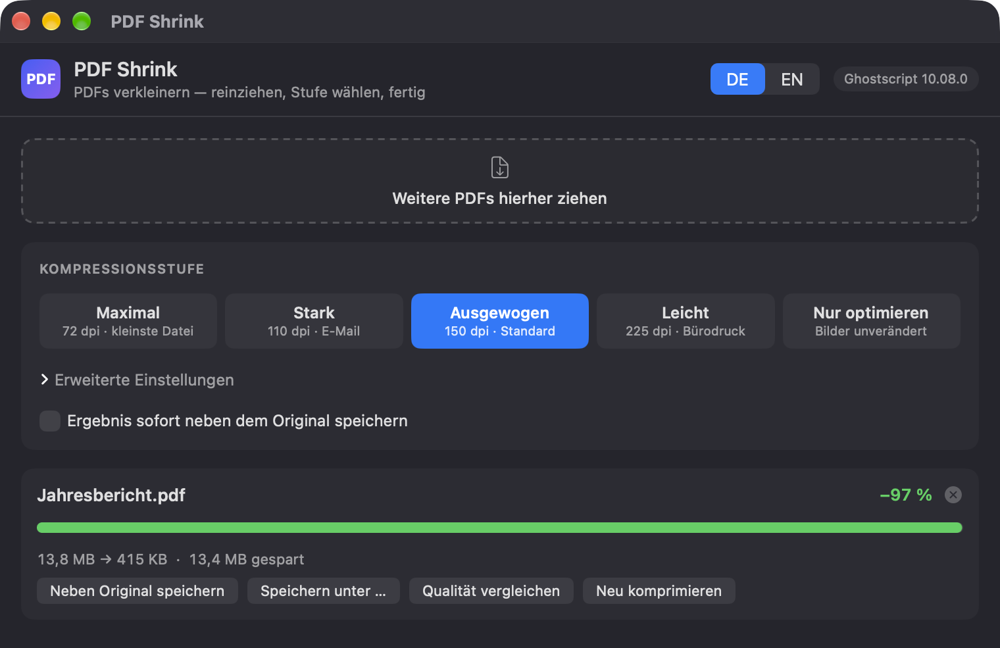
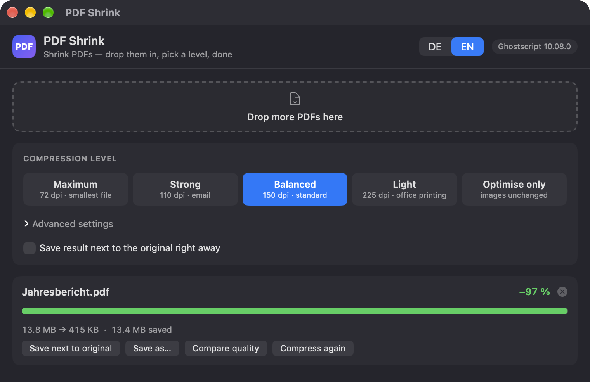

# PDF Shrink

**[Deutsch](#deutsch) · [English](#english)**

Native macOS app for shrinking PDF files. Drop PDFs into the window or onto the
dock icon, pick a compression level, done — no browser, no upload, no cloud.
The interface switches between German and English at the press of a button.

| Deutsch | English |
|---|---|
|  |  |

---

## Deutsch

Native macOS-App zum Verkleinern von PDF-Dateien. PDFs ins Fenster oder aufs
Dock-Icon ziehen, Kompressionsstufe wählen, fertig — kein Browser, kein Upload,
keine Cloud. Alles läuft lokal.

Komprimiert wird mit [Ghostscript](https://www.ghostscript.com), also mit
denselben Hebeln, die auch PDF-XChange Editor unter *Dateigröße reduzieren*
anbietet: Bild-Downsampling, JPEG-Requantisierung, Font-Subsetting,
Duplikat-Erkennung, Metadaten entfernen.

### Installation

Fertige App unter [Releases](../../releases) herunterladen, entpacken, dann:

1. **`PDF Shrink.app` nach „Programme" ziehen.** Erst verschieben, dann
   starten — solange die App im Download-Ordner liegt, kennt macOS sie noch
   nicht richtig und aufs Icon gezogene PDFs kommen unter Umständen nicht an.

2. **Quarantäne entfernen.** Die App ist nicht bei Apple registriert, deshalb blockiert macOS sie zunächst mit der
   Meldung, sie sei beschädigt. Im Terminal:

   ```
   xattr -dr com.apple.quarantine "/Applications/PDF Shrink.app"
   ```

3. **Ghostscript installieren**, falls noch nicht vorhanden:

   ```
   brew install ghostscript
   ```

Voraussetzungen: macOS 14 oder neuer, Apple Silicon.

### Bedienung

PDFs ins Fenster ziehen oder aufs Dock-Icon legen — mehrere gleichzeitig.
Jede Datei wird sofort mit der aktiven Stufe komprimiert, zwei parallel;
die Fortschrittsanzeige zählt die Seiten mit.

| Stufe | Bildauflösung | gedacht für |
|---|---|---|
| Maximal | 72 dpi | kleinste Datei, reine Bildschirmansicht |
| Stark | 110 dpi | E-Mail-Anhang |
| Ausgewogen | 150 dpi | Standard |
| Leicht | 225 dpi | Bürodruck |
| Nur optimieren | unverändert | Bilder bleiben unangetastet, nur Struktur wird aufgeräumt |

Unter **Erweiterte Einstellungen**: Bildauflösung, JPEG-Qualität, Auflösung für
Schwarz-Weiß-Scans, PDF-Version, Graustufen-Umwandlung, Metadaten entfernen,
Web-Optimierung (linearisiert).

Pro Datei: **Neben Original speichern** (legt `<name>_komprimiert.pdf` daneben,
nummeriert bei Namenskollision), **Speichern unter …**, **Qualität vergleichen**
(Seite vorher/nachher nebeneinander) und **Neu komprimieren** nach geänderten
Einstellungen. Mit der Option *Ergebnis sofort neben dem Original speichern*
läuft das ohne Rückfrage durch.

Das Original wird nie verändert oder überschrieben. Wird eine Datei durch das
Neuschreiben größer (kommt bei bereits optimierten PDFs vor), liefert die App
das unveränderte Original und sagt das auch.

**Sprache:** Der Schalter `DE | EN` oben rechts stellt die Oberfläche sofort um,
ohne Neustart. Beim ersten Start folgt die App der Systemsprache; danach gilt
die getroffene Wahl.

### Selbst bauen

```
git clone https://github.com/makogre/pdf-shrink.git
cd pdf-shrink
./build.sh          # kompilieren, signieren, nach ~/Applications installieren
./release.sh        # verteilbares ZIP in dist/ erzeugen
./selftest.sh x.pdf # Kompressionslogik gegen ein echtes PDF prüfen
```

Gebraucht werden Xcode (für `swiftc` und das macOS-SDK) und Ghostscript.
Es gibt kein Xcode-Projekt — `build.sh` ruft `swiftc` direkt auf und setzt das
Bundle zusammen.

### Technik

Das Ergebnis landet zuerst in einem Zwischenordner; geschrieben wird erst beim
Speichern. Der Seitenfortschritt kommt aus Ghostscripts stdout
(`Processing pages 1 through N.` / `Page n`). Seitenzahl, Vorschaubilder und die
Erkennung passwortgeschützter Dateien laufen über PDFKit.

Eine Stolperfalle, die hier gelöst ist: `-dJPEGQ` wirkt bei `pdfwrite` **nicht**
(das gilt nur für JPEG-Ausgabegeräte). Die Bildqualität läuft über
`setdistillerparams` mit `/QFactor`; die Kennlinie in
`Ghostscript.qFactor(for:)` bildet die Distiller-Stufen nach
(Maximum 0.1 / Hoch 0.4 / Mittel 0.76 / Niedrig 1.3 / Minimum 2.4).

Die Übersetzungen stehen als Felder einer Struktur in `Sources/Strings.swift`.
Dadurch erzwingt der Compiler, dass jeder Text in beiden Sprachen existiert.
Fehler werden als Fall gespeichert statt als fertiger Satz — sonst bliebe eine
Meldung in der Sprache stehen, in der sie entstanden ist.

### Grenzen

- Passwortgeschützte PDFs werden erkannt und mit Klartext-Meldung abgelehnt.
- Signaturen gehen beim Neuschreiben verloren — das ist bei jedem Optimierer so.
- Gescannte Seiten als 1-Bit-Bild reagieren auf *Auflösung Schwarz-Weiß-Bilder*,
  nicht auf die JPEG-Qualität.
- Nur Apple Silicon. Ein Universal Binary wäre machbar, ist aber nicht gebaut.
- Ghostscript wird nicht mitgeliefert, sondern aufgerufen.

---

## English

Native macOS app for shrinking PDF files. Drop PDFs into the window or onto the
dock icon, pick a compression level, done — no browser, no upload, no cloud.
Everything runs locally.

Compression is done by [Ghostscript](https://www.ghostscript.com), using the
same levers that PDF-XChange Editor offers under *Reduce File Size*: image
downsampling, JPEG requantisation, font subsetting, duplicate detection,
metadata removal.

### Installation

Download the app from [Releases](../../releases), unzip it, then:

1. **Move `PDF Shrink.app` to Applications.** Move first, launch second — while
   the app sits in your downloads folder macOS does not know it properly, and
   PDFs dropped onto its icon may not arrive.

2. **Remove the quarantine flag.** The app is not registered with Apple (that
   costs €99/year), so macOS blocks it at first, claiming it is damaged. In
   Terminal:

   ```
   xattr -dr com.apple.quarantine "/Applications/PDF Shrink.app"
   ```

3. **Install Ghostscript** if you don't have it:

   ```
   brew install ghostscript
   ```

Requirements: macOS 14 or newer, Apple Silicon.

### Usage

Drop PDFs into the window or onto the dock icon — several at once is fine.
Each file is compressed immediately at the selected level, two at a time; the
progress bar counts pages as it goes.

| Level | Image resolution | Intended for |
|---|---|---|
| Maximum | 72 dpi | smallest file, screen viewing only |
| Strong | 110 dpi | email attachments |
| Balanced | 150 dpi | the default |
| Light | 225 dpi | office printing |
| Optimise only | unchanged | images left untouched, only structure cleaned up |

Under **Advanced settings**: image resolution, JPEG quality, resolution for
black-and-white scans, PDF version, greyscale conversion, metadata removal,
web optimisation (linearised).

Per file: **Save next to original** (writes `<name>_komprimiert.pdf` alongside,
numbered if the name is taken), **Save as…**, **Compare quality** (one page
before and after, side by side) and **Compress again** after changing settings.
With *Save result next to the original right away* this happens without asking.

The original is never modified or overwritten. If rewriting would make a file
larger (which happens with already-optimised PDFs), the app hands you the
untouched original and says so.

**Language:** the `DE | EN` switch in the top right changes the interface
instantly, without a restart. On first launch the app follows your system
language; after that it remembers your choice.

### Building from source

```
git clone https://github.com/makogre/pdf-shrink.git
cd pdf-shrink
./build.sh          # compile, sign, install into ~/Applications
./release.sh        # produce a distributable ZIP in dist/
./selftest.sh x.pdf # check the compression logic against a real PDF
```

You need Xcode (for `swiftc` and the macOS SDK) and Ghostscript. There is no
Xcode project — `build.sh` calls `swiftc` directly and assembles the bundle.

### How it works

The result goes to a temporary folder first; nothing is written until you save.
Page progress is parsed from Ghostscript's stdout (`Processing pages 1 through
N.` / `Page n`). Page counts, preview images and detection of password-protected
files go through PDFKit.

One pitfall solved here: `-dJPEGQ` has **no effect** on `pdfwrite` (it only
applies to JPEG output devices). Image quality is controlled through
`setdistillerparams` with `/QFactor`; the curve in `Ghostscript.qFactor(for:)`
mirrors the Distiller presets (Maximum 0.1 / High 0.4 / Medium 0.76 /
Low 1.3 / Minimum 2.4).

Translations live as fields of a struct in `Sources/Strings.swift`, so the
compiler enforces that every string exists in both languages. Errors are stored
as cases rather than finished sentences — otherwise a message would stay in
whichever language it was created in.

### Limitations

- Password-protected PDFs are detected and rejected with a plain message.
- Signatures are lost when rewriting — true of any optimiser.
- Scanned pages stored as 1-bit images respond to *resolution for
  black-and-white images*, not to JPEG quality.
- Apple Silicon only. A universal binary would be feasible but isn't built.
- Ghostscript is called, not bundled.

---

## Aufbau / Layout

```
Sources/Models.swift        Stufen und Einstellungen          levels and settings
Sources/Strings.swift       Alle Texte, DE und EN             all strings, DE and EN
Sources/Ghostscript.swift   Argumente, QFactor-Kennlinie      arguments, QFactor curve
Sources/Runner.swift        Prozesslauf und Fortschritt       process run and progress
Sources/Store.swift         Warteschlange und Speichern       queue and saving
Sources/ContentView.swift   Hauptfenster                      main window
Sources/FileRow.swift       Zeile pro Datei                   one row per file
Sources/CompareView.swift   Vorher/Nachher-Vergleich          before/after comparison
Sources/App.swift           Einstieg, Dock-Drops              entry point, dock drops
Tests/SelfTest.swift        Selbsttest                        self-test
icon/                       Icon-Quelle und app.icns          icon source and app.icns
```

## Lizenz / License

[MIT](LICENSE). Ghostscript itself is AGPLv3 and is called by this app, not
redistributed with it.
