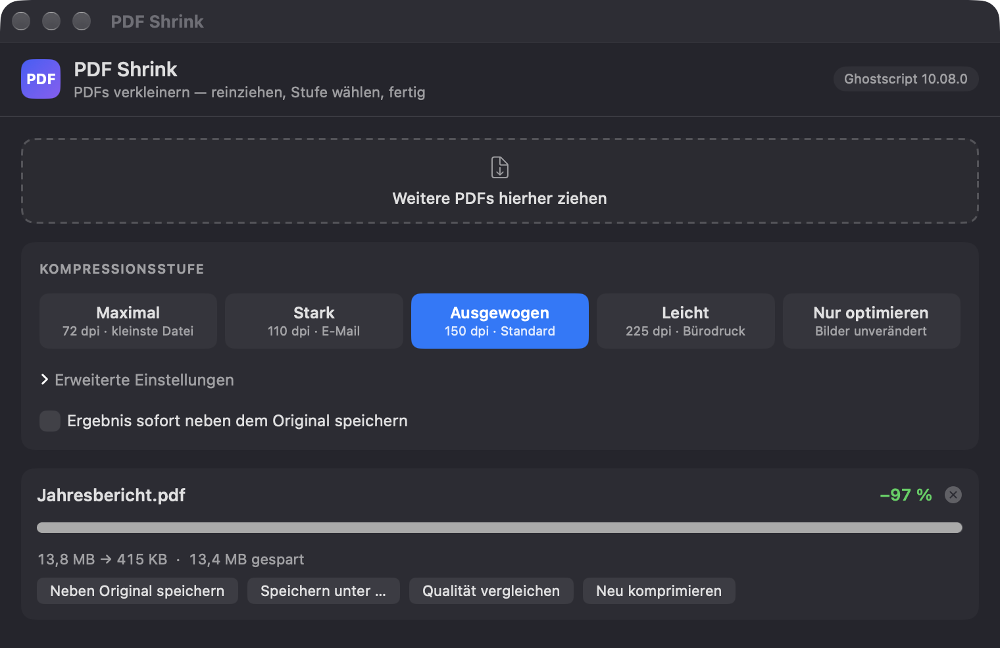

# PDF Shrink

Native macOS-App zum Verkleinern von PDF-Dateien. PDFs ins Fenster oder aufs
Dock-Icon ziehen, Kompressionsstufe wählen, fertig — kein Browser, kein
Upload, keine Cloud. Alles läuft lokal.



Komprimiert wird mit [Ghostscript](https://www.ghostscript.com), also mit
denselben Hebeln, die auch PDF-XChange Editor unter *Dateigröße reduzieren*
anbietet: Bild-Downsampling, JPEG-Requantisierung, Font-Subsetting,
Duplikat-Erkennung, Metadaten entfernen.

## Installation

Fertige App unter [Releases](../../releases) herunterladen, entpacken, dann:

1. **`PDF Shrink.app` nach „Programme" ziehen.** Erst verschieben, dann
   starten — solange die App im Download-Ordner liegt, kennt macOS sie noch
   nicht richtig und aufs Icon gezogene PDFs kommen unter Umständen nicht an.

2. **Quarantäne entfernen.** Die App ist nicht bei Apple registriert
   (das kostet 99 €/Jahr), deshalb blockiert macOS sie zunächst mit der
   Meldung, sie sei beschädigt. Im Terminal:

   ```
   xattr -dr com.apple.quarantine "/Applications/PDF Shrink.app"
   ```

3. **Ghostscript installieren**, falls noch nicht vorhanden:

   ```
   brew install ghostscript
   ```

Voraussetzungen: macOS 14 oder neuer, Apple Silicon.

## Bedienung

PDFs ins Fenster ziehen oder aufs Dock-Icon legen — mehrere gleichzeitig.
Jede Datei wird sofort mit der aktiven Stufe komprimiert, zwei parallel;
die Fortschrittsanzeige zählt die Seiten mit.

| Stufe | Bildauflösung | gedacht für |
|---|---|---|
| Maximal | 72 dpi | kleinste Datei, reine Bildschirmansicht |
| Stark | 110 dpi | E-Mail-Anhang |
| Ausgewogen | 150 dpi | Standard |
| Leicht | 225 dpi | Bürodruck |
| Nur optimieren | unverändert | Bilder bleiben unangetastet, nur Struktur wird aufgeräumt |

Unter **Erweiterte Einstellungen**: Bildauflösung, JPEG-Qualität, Auflösung für
Schwarz-Weiß-Scans, PDF-Version, Graustufen-Umwandlung, Metadaten entfernen,
Web-Optimierung (linearisiert).

Pro Datei: **Neben Original speichern** (legt `<name>_komprimiert.pdf` daneben,
nummeriert bei Namenskollision), **Speichern unter …**, **Qualität vergleichen**
(Seite vorher/nachher nebeneinander) und **Neu komprimieren** nach geänderten
Einstellungen. Mit der Option *Ergebnis sofort neben dem Original speichern*
läuft das ohne Rückfrage durch.

Das Original wird nie verändert oder überschrieben. Wird eine Datei durch das
Neuschreiben größer (kommt bei bereits optimierten PDFs vor), liefert die App
das unveränderte Original und sagt das auch.

## Selbst bauen

```
git clone https://github.com/makogre/pdf-shrink.git
cd pdf-shrink
./build.sh          # kompilieren, signieren, nach ~/Applications installieren
./release.sh        # verteilbares ZIP in dist/ erzeugen
./selftest.sh x.pdf # Kompressionslogik gegen ein echtes PDF prüfen
```

Gebraucht werden Xcode (für `swiftc` und das macOS-SDK) und Ghostscript.
Es gibt kein Xcode-Projekt — `build.sh` ruft `swiftc` direkt auf und setzt das
Bundle zusammen.

## Technik

Das Ergebnis landet zuerst in einem Zwischenordner; geschrieben wird erst beim
Speichern. Der Seitenfortschritt kommt aus Ghostscripts stdout
(`Processing pages 1 through N.` / `Page n`). Seitenzahl, Vorschaubilder und die
Erkennung passwortgeschützter Dateien laufen über PDFKit.

Eine Stolperfalle, die hier gelöst ist: `-dJPEGQ` wirkt bei `pdfwrite` **nicht**
(das gilt nur für JPEG-Ausgabegeräte). Die Bildqualität läuft über
`setdistillerparams` mit `/QFactor`; die Kennlinie in
`Ghostscript.qFactor(for:)` bildet die Distiller-Stufen nach
(Maximum 0.1 / Hoch 0.4 / Mittel 0.76 / Niedrig 1.3 / Minimum 2.4).

## Grenzen

- Passwortgeschützte PDFs werden erkannt und mit Klartext-Meldung abgelehnt.
- Signaturen gehen beim Neuschreiben verloren — das ist bei jedem Optimierer so.
- Gescannte Seiten als 1-Bit-Bild reagieren auf *Auflösung Schwarz-Weiß-Bilder*,
  nicht auf die JPEG-Qualität.
- Nur Apple Silicon. Ein Universal Binary wäre machbar, ist aber nicht gebaut.
- Ghostscript wird nicht mitgeliefert, sondern aufgerufen.

## Aufbau

```
Sources/Models.swift        Stufen, Einstellungen, Formatierung
Sources/Ghostscript.swift   gs finden, Argumente bauen, QFactor-Kennlinie
Sources/Runner.swift        Prozesslauf, Fortschritt aus stdout, Abbruch
Sources/Store.swift         Warteschlange, Jobzustand, Speichern
Sources/ContentView.swift   Hauptfenster, Drag & Drop, Einstellungen
Sources/FileRow.swift       Zeile pro Datei mit Fortschritt und Aktionen
Sources/CompareView.swift   Vorher/Nachher-Vergleich (PDFKit)
Sources/App.swift           Einstieg, Dock-Drops, Ghostscript-Warnung
Tests/SelfTest.swift        Selbsttest gegen echtes Ghostscript
icon/                       Icon-Quelle (PostScript) und app.icns
```

## Lizenz

[MIT](LICENSE). Ghostscript selbst steht unter der AGPLv3 und wird von dieser
App nur aufgerufen, nicht mitgeliefert.
